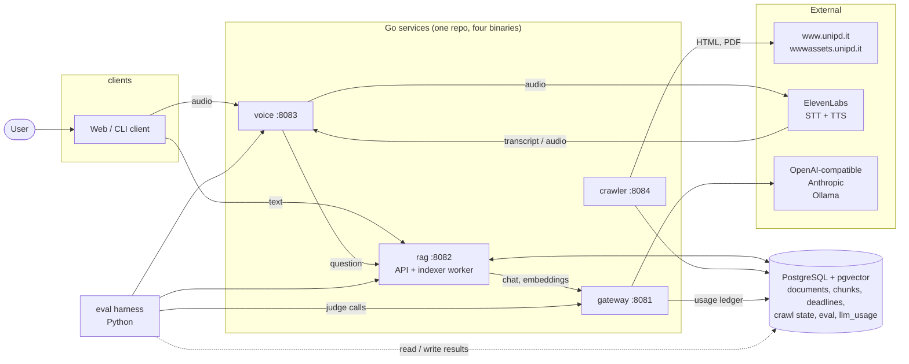

# Architecture

Status: draft v0.1 (scaffolding session). Decisions are recorded in [`docs/adr/`](adr/); the schema is in [`DATA_MODEL.md`](DATA_MODEL.md).

## 1. Goals and the one rule that shapes everything

The assistant answers questions about the University of Padua: admission documents and procedures, deadlines for a given academic year, and requirements of the regional scholarship. **A wrong date can cost a student their scholarship**, so the design optimises for *verifiable* answers over fluent ones:

1. Every answer carries citations (URL + document date + crawl date).
2. Every answer carries an "as of" date and the academic year it applies to.
3. If the official documents don't contain the answer, the system says so. It does not guess.
4. Dates come from a structured, quote-verified table, not from free-form generation.
5. 2025/26 and 2026/27 content is never mixed unless the user explicitly asks.

## 2. Components



| Component | Owns | Never does |
|---|---|---|
| **gateway** | Provider adapters, retry, fallback, cache, cost accounting, SSE passthrough, `/metrics` | Know about universities, prompts or retrieval |
| **crawler** | Fetching, robots/rate limits, parsing, chunking, versioning, change detection | Call an LLM or embed anything |
| **rag** | Retrieval, answer generation, citation enforcement, deadlines store, **indexer worker** (embeds chunks, extracts deadlines, promotes versions) | Fetch from the web |
| **voice** | STT → RAG → streaming TTS, sentence chunking for low latency | Retrieve or generate answers itself |
| **eval** (Python) | Golden set, metrics, reports | Run in production |

Cross-cutting rules:

- **LLM calls only through the gateway**, including embeddings and the eval judge. ElevenLabs is *not* an LLM and is called directly by `voice`.
- **Postgres is the only datastore and also the work queue.** A worker *claims* a version with one short statement (`FOR UPDATE SKIP LOCKED`) that sets a lease (`index_status='indexing'`, `claimed_by`, `claimed_at`) and **commits before any gateway call**; no transaction or row lock is held across network I/O, and expired leases are re-claimable (ADR-0011). No Redis, no message broker. See ADR-0002, ADR-0007.
- Crawler and RAG communicate **only through the database**. This keeps the crawler free of LLM coupling and means a crawl never blocks on a provider outage.
- Services are stateless; all long-lived state is in Postgres or `DATA_DIR` (raw downloaded files).
- Tracing: W3C `traceparent` propagated on every hop (voice → rag → gateway), `trace_id` returned in API responses and stored in `llm_usage`.

## 3. Data flows

### 3a. Crawl → ingest → index

```mermaid
sequenceDiagram
    autonumber
    participant S as Scheduler (crawler)
    participant F as Fetcher
    participant U as unipd.it hosts
    participant P as Parser + Chunker
    participant DB as Postgres
    participant W as Indexer worker (rag)
    participant G as Gateway

    S->>DB: insert crawl_jobs row
    S->>U: sitemap.xml (www.unipd.it) → keep URLs under allowed path prefixes
    S->>DB: upsert crawl_urls (discovered_via = seed / sitemap / link)
    S->>DB: select crawl_urls due (next_fetch_at <= now)
    loop each due URL (per-host rate limit)
        F->>U: GET /robots.txt per host (cached; RFC 9309 mapping below)
        alt robots 5xx / 429 / network error
            F->>DB: host paused, retry later (no crawling, not "disallow forever")
        else disallowed by robots
            F->>DB: crawl_urls.state = blocked_robots
        else allowed (2xx rules permit, or any other 4xx incl. 401/403 = no restrictions)
            F->>U: GET url + If-None-Match / If-Modified-Since
            alt 304 or identical raw_hash
                F->>DB: state = not_modified, bump next_fetch_at
            else 200
                F->>P: bytes + headers (X-Robots-Tag, Last-Modified)
                P->>P: HTML main content / pdftotext, detect year, doc type, language, date
                P->>P: published_at = document date, else Last-Modified (published_at_source)
                P->>P: content_hash = sha256(textnorm.Normalize(text))
                alt content_hash already stored for this document
                    P->>DB: touch last_seen_at only
                else new content
                    P->>DB: INSERT document_versions (index_status=pending, is_current=false, x_robots_tag) + chunks (embedding NULL)
                    P->>DB: HTML only: add discovered links to crawl_urls (PDF responses never yield links)
                end
            end
        end
    end
    S->>DB: finish crawl_jobs (stats)

    loop worker poll
        W->>DB: FailExhaustedVersions (attempts >= max → failed)
        W->>DB: claim: one UPDATE … FOR UPDATE SKIP LOCKED sets index_status=indexing, claimed_by, claimed_at, attempts+1; COMMITS
        Note over W,DB: no transaction or lock is held from here on
        W->>G: POST /v1/embeddings (batch, alias "embed"); heartbeat ExtendLease every INDEXER_HEARTBEAT
        W->>DB: UPDATE chunks SET embedding (idempotent)
        opt Italian original of a bando/avviso (not a translation)
            W->>G: POST /v1/chat/completions (alias "extract", JSON schema)
            W->>W: validate (datex + textnorm): quote verbatim, dates inside quote, ISO dates sane
            W->>DB: INSERT deadlines (quote_verified, date_in_quote, review_status=unreviewed)
        end
        W->>DB: TX (fenced on claimed_by): CompleteIndexing; old version is_current=false, new true;<br/>chunks.is_current + deadlines.is_current follow
        Note over W,DB: 0 rows affected = lease was lost → discard, never overwrite the new owner
    end
```

Key properties:

- **The old version keeps being served until the new one is fully indexed.** A half-embedded or failed new version is invisible to retrieval.
- **Crash safety:** a worker that dies leaves `index_status='indexing'` with a stale `claimed_at`; after `INDEXER_LEASE_TIMEOUT` (default 10 min) any worker may re-claim it. `index_attempts` is incremented at claim time, so a version that keeps killing workers still reaches `INDEXER_MAX_ATTEMPTS` and becomes `failed` (alert). Transient errors go back to `pending` with exponential backoff (`index_next_attempt_at`). All worker writes are fenced on `claimed_by`. See ADR-0011.
- **robots.txt (RFC 9309):** 2xx → follow the rules; any 4xx (incl. 401/403, e.g. `wwwassets.unipd.it`) → no restrictions; 5xx, 429 or network error → crawl nothing on that host *for now* and retry with backoff.
- **Discovery:** sitemap entries under the configured path prefixes are the primary source; link-following from HTML seed pages (max depth) is secondary. **Links are never taken from PDFs** (they carry `X-Robots-Tag: noindex, nofollow`; the header is stored on the version).
- **Corrections arrive as new files** (`…_0.pdf`, `…_1.pdf`) while old PDFs are cached by the CDN for a year. So listing pages are re-crawled daily to find *new links*, while known PDFs are re-checked weekly with a conditional GET.
- **Translations:** the English bando is a separate document with `translation_of` → the Italian original. Both are chunked and embedded; **deadlines are extracted from the Italian original only** (ADR-0010).
- **Manual ingestion** (`POST /admin/ingest`, §4.4) feeds the same pipeline for files a site blocks for bots.

### 3b. Text question → answer

```mermaid
sequenceDiagram
    autonumber
    participant C as Client
    participant R as rag
    participant G as Gateway
    participant DB as Postgres

    C->>R: POST /v1/ask {question, language?, academic_year?, stream}
    par t=0: language / year / intent, then Italian translation
        R->>G: alias "fast": detect language, extract explicit year, classify intent, translate to Italian
        G-->>R: {language, year?, intent, question_it}
    and t=0: start the vector leg immediately (bge-m3 is cross-lingual: original question, no translation needed)
        R->>G: embed original question (alias "embed")
        G-->>R: query vector
        R->>DB: vector search (cosine), top 30, default academic year (speculative)
    end
    Note over R: if "fast" extracted a different year → re-run only the cheap vector SQL with the new filter (the embedding is reused)
    par after "fast" returns
        R->>DB: lexical query from question_it (Italian config), top 30
    and deadline intent only
        R->>DB: SELECT FROM servable_deadlines WHERE academic_year = …<br/>(is_current AND quote_verified AND date_in_quote AND review_status<>'rejected')
    end
    R->>R: RRF fusion → top 8 chunks (prefer one language per document family); build context with [n] source ids
    alt nothing above relevance floor AND no deadline rows
        R-->>C: status=not_found, "not found in official documents", no citations
    else
        R-->>C: SSE meta {citations, academic_year, as_of, status}
        R->>G: alias "smart", stream, context + strict system prompt, answer in user's language
        G-->>R: token deltas
        R-->>C: SSE delta …
        R->>R: post-checks: every [n] valid; every date in the answer ∈ dates in the context (datex, normalised ISO); else flag
        R-->>C: SSE done {verified, warnings, usage, timings}
    end
```

Design notes:

- **Latency:** the expensive vector path (embedding call) starts at t=0 in parallel with the `fast` call; only the lexical leg waits for the Italian translation. Retrieval latency ≈ max(fast + lexical, embed + vector) instead of their sum.
- **Retrieval filter is applied inside SQL**, not after: `is_current AND academic_year IN (:year) [OR academic_year IS NULL for evergreen pages]`. The default year comes from `RAG_CURRENT_ACADEMIC_YEAR`; a user asking about "last year" or naming 2025/26 switches the filter, and the answer says which year it used.
- **Cross-lingual**: the vector side handles RU/EN→IT. The lexical leg needs Italian terms, hence the translation (the original question is kept too).
- **Deadlines**: for deadline-intent questions the date values in the prompt come from `servable_deadlines` rows (with their `source_quote`); the model is told to copy them verbatim. Serving predicate (single definition, DB view `servable_deadlines`): `is_current AND quote_verified AND date_in_quote AND review_status <> 'rejected'`.
- **Date guard:** dates are compared as **normalised calendar dates**, not strings (`internal/datex`). It parses Italian, English and Russian month names and numeric forms (`30 settembre 2026`, `September 30, 2026`, `30 сентября 2026 г.`, `30/09/2026`, `30.09.2026`, ISO), ranges with shared parts (`dal 1 al 30 settembre 2026`) and month-level mentions (`marzo 2027`). An answer date is *supported* if the context contains a date with the same day and month and a compatible year (a year-less date in the answer is matched on day+month). Calendar-impossible dates (`31 settembre`) are never supported. The guard sets `verified=false` and a warning listing the unsupported dates.
- **Date format rule:** the answer prompt instructs the model to write every date with the month name (never numerically) in the answer language (`rag.DateFormatRule`, ADR-0008). The guard reads numeric dates day-first and flags any numeric date in an answer as a `numeric_date` warning.
- **Streaming and verification**: tokens are streamed before post-checks run, so `done.verified=false` tells the client to show a warning. For voice, the guard runs per sentence before the sentence is sent to TTS (§3c).
- **"As of"**: `as_of` is the date the answer was generated. `oldest_source_crawled_at` is the **oldest crawl time among the cited sources** (min `fetched_at`): the answer is at least that fresh and could be that stale, so it is the number to show next to "as of".
- **Translations in context:** when both the Italian and English version of a document are retrieved, the Italian chunk is always kept (it is the legally valid text); the English chunk is added only as a secondary, informational source. Citations list the Italian original first, and an English translation carries `informational_translation: true` (ADR-0008, ADR-0010).

### 3c. Voice question → spoken answer

```mermaid
sequenceDiagram
    autonumber
    participant C as Client
    participant V as voice
    participant E as ElevenLabs
    participant R as rag

    C->>V: POST /v1/voice/ask (audio upload)
    V->>E: STT scribe_v3 (batch, keyterms from config/keyterms.txt)
    E-->>V: transcript + detected language
    V-->>C: SSE transcript {text, language}
    V->>R: POST /v1/ask {question, language, stream:true}
    R-->>V: SSE meta {citations…}
    V-->>C: SSE citations {…}   (text, immediately)
    loop deltas
        R-->>V: delta
        V->>V: sentence splitter; on sentence boundary → date guard
        V->>E: TTS stream eleven_v4_turbo (sentence, previous_text for prosody; fallback eleven_flash_v2_5)
        E-->>V: audio chunks
        V-->>C: SSE audio {seq, mime, base64}
    end
    R-->>V: done
    V-->>C: SSE done {timings: stt_ms, rag_first_token_ms, ttfa_ms}
```

Latency budget (targets, to be measured in M5): STT ≤ 1.0 s for a 5 s utterance; RAG first token ≤ 1.5 s; first sentence boundary ≈ 0.5 s later; TTS first byte ≤ 0.4 s ⇒ **time-to-first-audio ≈ 3–3.5 s**. Mitigations: first sentence is allowed to be short (≥ 25 chars or first clause), TTS connection pre-warmed, RAG retrieval and embedding in parallel. STT latency is the hardest to hide; realtime/streaming STT is a later optimisation (ADR-0009).

## 4. API contracts

All JSON. All services expose `GET /healthz`, `GET /readyz`, `GET /metrics`. Errors use one envelope:

```json
{ "error": { "code": "provider_unavailable", "message": "…", "retryable": true, "trace_id": "…" } }
```

### 4.1 Gateway (`:8081`) — OpenAI-compatible surface + extensions

Compatible with the OpenAI chat/embeddings wire format so any standard client (and RAGAS) can use it by setting `base_url`.

**`POST /v1/chat/completions`**

```json
{
  "model": "smart",
  "messages": [{"role": "system", "content": "…"}, {"role": "user", "content": "…"}],
  "temperature": 0,
  "max_tokens": 800,
  "stream": false,
  "response_format": {"type": "json_schema", "json_schema": {"name": "deadlines", "schema": {}}},
  "metadata": {"caller": "rag", "purpose": "answer"}
}
```

`model` is an **alias** from `config/gateway.example.yaml` (an ordered provider chain). Response = OpenAI shape plus:

```json
{
  "id": "…", "model": "claude-sonnet-5-5",
  "choices": [{"index": 0, "message": {"role": "assistant", "content": "…"}, "finish_reason": "stop"}],
  "usage": {"prompt_tokens": 1234, "completion_tokens": 210, "cost_usd": 0.0071},
  "gateway": {"alias": "smart", "provider": "anthropic", "attempts": 2, "fallback_used": false, "cached": false, "request_id": "…", "latency_ms": 1840}
}
```

**Streaming** (`"stream": true`): `text/event-stream`, standard OpenAI chunks (`data: {"choices":[{"delta":{"content":"…"}}]}`), terminated by `data: [DONE]`. The final chunk before `[DONE]` carries `usage` and `gateway`. Fallback is only possible **before the first token** is sent; a mid-stream provider failure ends the stream with an `error` event (clients retry the whole request).

**`POST /v1/embeddings`** — `{"model": "embed", "input": ["…"], "metadata": {…}}` → OpenAI shape, `data[i].embedding` (1024 floats, L2-normalised), `gateway` block as above. Passes `input_type` hint (`query`|`document`) as an extension field.

Headers: `X-Request-Id` (in/out), `traceparent`. `Cache-Control: no-cache` from the caller bypasses the cache.

### 4.2 RAG (`:8082`)

**`POST /v1/ask`**

```json
{ "question": "Entro quando devo presentare la domanda per la borsa di studio?", "language": "it", "academic_year": "2026/27", "stream": false }
```

`language` and `academic_year` are optional (detect / server default).

Response (`stream: false`):

```json
{
  "answer": "La domanda … va presentata entro il … [1].",
  "language": "it",
  "status": "answered",
  "academic_year": "2026/27",
  "as_of": "2026-11-24",
  "oldest_source_crawled_at": "2026-11-23T04:00:12Z",
  "citations": [{
    "n": 1, "url": "https://…", "title": "Bando borse di studio a.a. 2026/27", "doc_type": "bando",
    "informational_translation": false,
    "academic_year": "2026/27", "section": "Art. 6",
    "published_at": "2026-07-10T00:00:00Z", "crawled_at": "2026-11-23T04:00:12Z",
    "quote": "…verbatim passage…"
  }],
  "deadlines": [{
    "event": "Scadenza presentazione domanda", "applies_to": "all",
    "starts_on": null, "ends_on": "2026-…", "time_of_day": "12:00", "date_text": "entro le ore 12:00 del …",
    "academic_year": "2026/27", "source_url": "https://…", "source_quote": "…", "reviewed": false
  }],
  "verified": true,
  "warnings": [],
  "trace_id": "…"
}
```

`oldest_source_crawled_at` is the **oldest crawl time among the cited sources**; `as_of` is the generation date. **Citation order:** Italian originals come first; a translation is listed after its original with `informational_translation: true` and `original_url` set (it is not legally valid; ADR-0010). `status` ∈ `answered | partial | not_found`. For `not_found`, `answer` states in the user's language that the information was not found in official documents and suggests the relevant office; `citations` is empty. `reviewed` is `true` only when a human confirmed the deadline row; clients should display unreviewed dates with a "check the source" hint.

**Streaming** (`stream: true`, `text/event-stream`), named events:

| event | data | when |
|---|---|---|
| `meta` | `{status, academic_year, as_of, citations[], deadlines[]}` | once, right after retrieval, before any text |
| `delta` | `{"text": "…"}` | per token group |
| `done` | `{verified, warnings[], usage{…}, timings{retrieval_ms, first_token_ms, total_ms}, trace_id}` | once |
| `error` | `{code, message, retryable}` | terminal |

Citations are sent **before** the text so voice and UI can render sources immediately.

**`GET /v1/deadlines?academic_year=2026/27&event_key=…`** — read-only access to the structured table (used by eval and for debugging). Returns the same `DeadlineRef` objects plus `review_status`.

### 4.3 Voice (`:8083`)

**`POST /v1/voice/ask`** — `multipart/form-data`: `audio` (file; webm/ogg/wav/mp3), optional `language`, `academic_year`, `voice_id`, and eval/debug overrides `keyterms` (`true`|`false`, default from `ELEVENLABS_STT_KEYTERMS`) and `tts_model` (default `ELEVENLABS_TTS_MODEL`; lets eval compare `eleven_v4_turbo` with `eleven_flash_v2_5` on identical questions). **The overrides are disabled by default** and only honoured when the service runs with `VOICE_ALLOW_OVERRIDES=true` (dev/eval); otherwise a request that sets either field is rejected with `400 overrides_disabled` (not silently ignored, so an eval can never measure the wrong configuration unnoticed). They cost money or change quality, so a public-facing instance must not accept them. Response: `text/event-stream`:

| event | data |
|---|---|
| `transcript` | `{"text": "…", "language": "ru"}` |
| `citations` | same `citations[]`/`deadlines[]` objects as RAG `meta` |
| `answer_text` | `{"text": "…"}` (sentence-level, mirrors what is spoken, for captions) |
| `audio` | `{"seq": 0, "mime": "audio/mpeg", "data": "<base64>"}` |
| `done` | `{"timings": {"stt_ms": …, "rag_first_token_ms": …, "ttfa_ms": …, "total_ms": …}, "verified": true, "trace_id": "…", "models": {"stt": "scribe_v3", "tts": "eleven_v4_turbo", "tts_fallback_used": false, "keyterms": 13}}` |
| `error` | `{code, message, retryable}` |

Base64-over-SSE is chosen for testability (curl, eval harness, any HTTP client). A WebSocket binary transport can be added behind the same internal pipeline (ADR-0009).

### 4.4 Crawler (`:8084`, admin only)

- `POST /admin/crawl` `{ "seed": "https://…", "force": false }` — manual run; `GET /admin/jobs?limit=20`.
- `POST /admin/ingest` — **manual ingestion fallback**. `multipart/form-data`: `file`, `source_url` (the original public URL; becomes `canonical_url` and is what citations show), `doc_type`, `language`, optional `translation_of` (canonical URL of the Italian original), optional `academic_year`. For documents a site blocks for bots: the operator downloads the file in a browser and submits it. It runs the same parse → version (`ingest_source='manual'`) → chunk → index → deadlines pipeline, subject to the same validation. CLI equivalent: `crawler ingest-file --url … --file … --type bando --lang it`. Intended for files the operator is entitled to access; it does not bypass robots.txt for crawling.

Both bound to localhost by default; no auth in v1 because they are not exposed.

## 5. Retrieval design (summary)

- **Dense**: bge-m3, 1024-d, cosine, HNSW partial index on current chunks. `embedding_model` stored per chunk; queries only compare same-model vectors.
- **Lexical**: Postgres `tsvector` (Italian config) + GIN. Ranked with `ts_rank_cd`. *This is not BM25* (no IDF-saturation); good enough at this corpus size, and a swap to `pg_search`/ParadeDB BM25 is isolated behind `TextSearcher` (ADR-0003).
- **Fusion**: Reciprocal Rank Fusion (k=60) over the two lists; no score normalisation needed.
- **Filters** in SQL: `is_current`, academic year, optional doc type/language. Both language versions of a bando are indexed; the Italian original is always kept and cited first, the English one is only an informational secondary source.
- **Structured side-channel**: deadline intent → `servable_deadlines` rows (`is_current AND quote_verified AND date_in_quote AND review_status <> 'rejected'`) go into the prompt as ground truth with their quotes.
- No reranker in v1; add a cross-encoder (via gateway or local) only if eval shows a context-precision problem.

## 6. Failure modes

| # | Failure | Detection | Handling | User-visible effect |
|---|---|---|---|---|
| F1 | LLM provider 5xx / 429 / timeout | `llm.Error.Retryable` | Gateway retries with exponential backoff + jitter (3 attempts), then falls to the next provider in the alias chain; breaker opens after N consecutive failures and half-opens after a cool-down | Slightly slower answer; `gateway.fallback_used=true` |
| F2 | All providers down | `ErrAllProvidersFailed` | Gateway → `503 provider_unavailable`. RAG: if retrieval worked but generation failed, return the retrieved citations and deadline rows without prose, with `warnings:["generation_unavailable"]`; dates still come from the table | Degraded but correct: sources + raw deadline rows, no prose |
| F3 | Provider fails mid-stream | stream read error | Cannot fall back after first token. Emit `error` event; client may retry (idempotent). Voice stops TTS cleanly and says a fixed "please retry" line | One retry needed |
| F4 | Embedding provider down at query time | embed call fails | Fall back to lexical-only retrieval; add `warnings:["lexical_only"]`. Deadline path unaffected | Possibly lower recall |
| F5 | Embedding provider down at index time | indexer error | Version goes back to `pending` with exponential backoff (`index_next_attempt_at`, `index_attempts`); after `INDEXER_MAX_ATTEMPTS` it becomes terminal `failed` and an alert fires. **Old version stays current** | None (data a bit stale); alert on failed versions and on age of oldest pending version |
| F6 | Stale data | `now() - fetched_at` of cited sources; failed/blocked recrawls | `oldest_source_crawled_at` in every answer; if any cited document hasn't been successfully re-fetched in > `STALE_AFTER` (default 7 days), add `warnings:["source_may_be_stale"]`; Prometheus gauge `crawl_url_age_seconds` + alert | Warning displayed beside "as of" |
| F7 | Document changed but not yet indexed | version with `index_status=pending` exists for the document | Old version served; gauge `index_pending_versions`; answer unaffected | Old (still official, still cited with its own date) content |
| F8 | Crawl blocked (robots, 403, 429, WAF/captcha) | status codes; robots check | **robots.txt per RFC 9309:** 2xx → obey rules; any 4xx incl. 401/403 → no restrictions (this is why `wwwassets.unipd.it`, whose robots.txt answers 403, is crawlable); 5xx / 429 / network error → crawl nothing on that host for now and retry with backoff (never cache "disallow all" forever). Fetch-level 429/503: honour `Retry-After`, per-host backoff, `consecutive_failures++`; after N failures mark URL `error` and alert. Never rotate UAs/IPs. For a document the site blocks for bots, use the **manual ingestion fallback** (`/admin/ingest`) | Stale-data warning (F6) if it persists |
| F9 | Site structure changes (selectors break, content suddenly empty) | parsed text length drops > 70 % vs previous version, or 0 sections | Treat as `parse_status=partial/failed`; **do not promote**; keep old version; alert | None |
| F10 | PDF parse failure / no text layer | `pdftotext` error or < N chars/page | `parse_status=failed` or `needs_ocr=true`; OCR fallback (`ocrmypdf`) as a later task; version not promoted; alert includes URL. Because bandi are the key documents, failure of a bando is a **high-severity alert** | Old bando version still served |
| F11 | Bad structure detection ("Art. N" regex finds nothing) | chunker returns 1 giant section | Fallback to heading/paragraph-based splitting with a size cap; flag `parse_status=partial` | Slightly worse retrieval |
| F12 | LLM extracts a wrong/hallucinated deadline | validator (`deadlines.Validate`): quote not found after `textnorm.Normalize` on both sides (the same function as `content_hash`), a claimed date not found as a complete calendar date inside the quote (`datex`: IT/EN/numeric/range forms), `ends_on < starts_on`, event_key not in vocabulary | Row stored with `quote_verified` / `date_in_quote` false and **excluded from answers**: only rows in the `servable_deadlines` view (`is_current AND quote_verified AND date_in_quote AND review_status <> 'rejected'`) are served; human review CLI to confirm/reject. Quotes from column-interleaved PDF tables (e.g. the bando's "RIEPILOGO SCADENZE") fail verification by design; deadlines come from the running text | Deadline question answered from prose chunks with a "verify" note, or `not_found` |
| F13 | Conflicting dates (bando vs avviso/rettifica) | two current rows, same `event_key`+`applies_to`+year, different dates. **Not caused by translations:** deadlines are extracted from the Italian original only, so the English bando never creates a second row | Serve the one from the **most recent `published_at`** and mention the other; add `warnings:["conflicting_sources"]` | Both shown with their dates |
| F14 | Wrong-year leakage | eval metric `year_correct`; SQL filter makes it structurally impossible by default | Explicit-year questions switch the filter; answer always states `academic_year` | — |
| F15 | Model ignores citation rules / invents a date | date guard + `[n]` validation | `verified=false` + warning; voice layer refuses to speak a sentence whose date fails the guard and says the sentence is unverified | Warning |
| F16 | Question out of scope / not in docs | retrieval below relevance floor and no deadline rows | `status=not_found`, fixed-template message in the user's language | Honest refusal |
| F17 | STT misrecognises domain terms | eval WER on ISEE/CFU/Uniweb; transcript echoed to client | `keyterms` biasing (config/keyterms.txt); the transcript is shown/returned so the user can see what was understood; low-confidence words → RAG gets original text and lexical leg uses fuzzy aliases | User can correct |
| F18 | TTS provider down | error from ElevenLabs | Voice returns text answer + citations and `error{code:tts_unavailable}` for audio | Text-only answer |
| F19 | Postgres down | readiness fails | Services report not-ready; gateway still works (usage ledger is best-effort and buffered, dropped when full) | Outage for rag/crawler |
| F20 | Cost runaway (loop, eval misconfig) | `llm_usage` + per-caller budget | Gateway per-caller daily budget cap (`429 budget_exceeded`) | Request rejected |
| F21 | Prompt injection inside a crawled page | — | Context is wrapped as untrusted data in the prompt; model has no tools; output is only text; date guard still applies | — |
| F22 | Indexer worker crashes or hangs mid-version | `index_status='indexing'` with `claimed_at` older than `INDEXER_LEASE_TIMEOUT` | Lease expires; another worker re-claims (attempts+1). Workers never hold a transaction/lock during gateway calls, heartbeat with `ExtendLease`, and every write is fenced on `claimed_by` so a worker that lost its lease cannot overwrite the new owner. Crash loops end at `INDEXER_MAX_ATTEMPTS` → `failed` + alert | None (old version keeps serving) |
| F23 | Two language versions of a bando disagree or duplicate (the English Art. 1 even says "2025/26" and "Regional Council" where the Italian says 2026/27 and *Giunta*) | translation pair (`translation_of`) | Only the Italian original is authoritative (ADR-0010): deadlines come from it alone, the English chunks are retrieval-only and cited after it as informational. Academic year is never taken from a translation's body text (seed config / title / majority). Eval: golden entries in EN/RU must match the Italian date | — |
| F24 | A document is blocked for bots but needed | crawl_urls state / 403 on the file itself | Manual ingestion fallback with the original URL as the citation | Document available after the operator ingests it |

(F2 is the one place where a degraded mode exists on purpose: if generation is down, showing the verified table rows is better than showing nothing.)

## 7. Observability

- **Metrics** (Prometheus): gateway — `llm_requests_total{alias,provider,status}`, `llm_latency_seconds`, `llm_ttft_seconds`, `llm_tokens_total{direction}`, `llm_cost_usd_total`, `llm_cache_hits_total`, `llm_fallbacks_total`, breaker state. Crawler — fetch outcomes, `crawl_url_age_seconds`, parse failures by type. RAG — retrieval latency per leg, answer status counts, `index_pending_versions`, guard failures. Voice — `stt_seconds`, `ttfa_seconds`, `tts_first_byte_seconds`.
- **Logs**: `slog` JSON, always with `service`, `trace_id`, `request_id`. No question text at INFO (privacy); DEBUG only.
- **Tracing**: OpenTelemetry, OTLP exporter, spans for each pipeline stage; Jaeger via the `tracing` compose profile.

## 8. Security and privacy

- Secrets only via env; `.env` is git-ignored; `config/*.yaml` references env var *names*.
- No user accounts or PII are stored; question text is not persisted by default.
- Crawler identifies itself with a contact-bearing User-Agent and obeys robots.txt. Allowed hosts are an explicit allowlist.
- Admin endpoints listen on localhost only.

## 9. Planned third-party dependencies (introduced per milestone)

`jackc/pgx/v5`, `pgvector/pgvector-go`, `pressly/goose` (tool), `sqlc` (tool), `prometheus/client_golang`, `go.opentelemetry.io/otel` + `otelhttp`, `golang.org/x/net/html` (+ `PuerkitoBio/goquery`), `temoto/robotstxt`, `golang.org/x/time/rate`, a YAML lib for gateway config. PDF text: poppler `pdftotext` as a subprocess. Python eval: `ragas`, `jiwer`, `httpx`, `psycopg`.

## 10. Open questions

1. ~~Scholarship bando host~~ — **resolved** (ADR-0010): the 2026/27 bando is published by unipd.it itself (`www.unipd.it/borse-studio-alloggi`, PDFs on `wwwassets.unipd.it`). ESU Padova is out of scope for M2.
2. ~~ElevenLabs STT keyterms / models~~ — **resolved** (ADR-0009, verified 2026-11-24): STT `scribe_v3` batch, later `scribe_v3_live`; TTS `eleven_v4_turbo` with fallback `eleven_flash_v2_5`; `keyterms` supported (billed extra), list validated at startup against the realtime limits. Remaining check: re-confirm ids and limits when M5 starts.
3. Preferred concrete model names/prices in `gateway.example.yaml` (placeholders now).
4. ~~Which language prevails if the Italian and English bando differ~~ — **resolved** (ADR-0010, verified 2026-11-24). English bando: *"This call for applications has been translated into English for information purposes only. Only the Italian version is valid for all legal purposes."* Italian Art. 1: in case of discrepancy the provisions of the *Deliberazione della Giunta regionale* on which the call is based prevail. Hierarchy: regional resolution > Italian bando > English translation (informational). Indexing the resolution itself is out of scope for now.
5. ~~`X-Robots-Tag: noindex`~~ — **decided** (ADR-0010): acceptable for a personal, non-public project (we store the header, honour `nofollow`, index only for our own retrieval and cite/link the original). **Must be revisited if the service is ever made public.**
