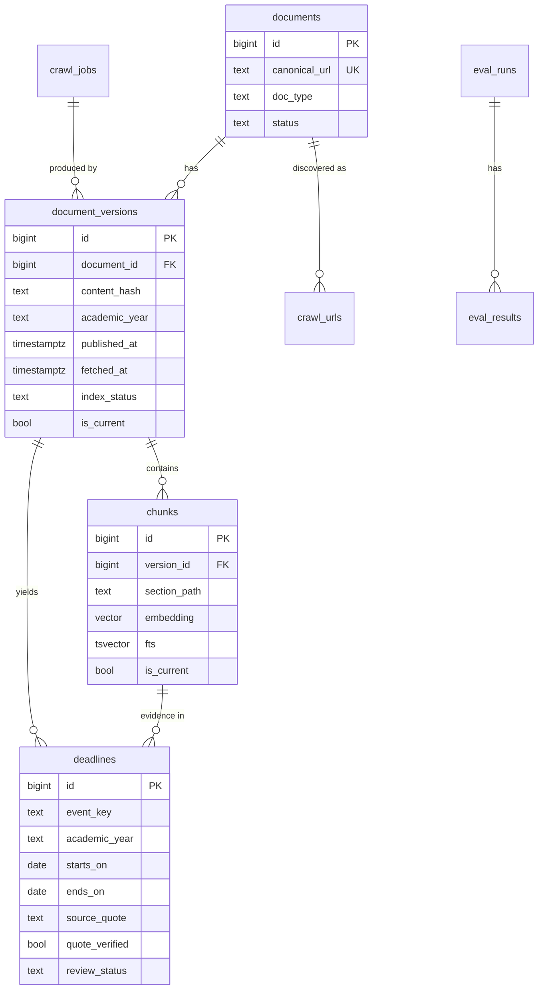

# Data model

PostgreSQL 17 + pgvector. Migrations: [`migrations/`](../migrations) (goose). Rationale: ADR-0002, ADR-0004, ADR-0010.

## Entity overview



## Tables

| Table | Purpose | Written by | Read by |
|---|---|---|---|
| `crawl_jobs` | One row per crawler run; config snapshot and stats | crawler | ops, metrics |
| `crawl_urls` | Per-URL crawl state: ETag, next fetch time, failures, robots/out-of-scope outcome, `discovered_via` (seed/sitemap/link/manual) | crawler | crawler |
| `documents` | Stable source URL, default `doc_type`, liveness (`active/gone/excluded`), `translation_of` (→ the Italian original) | crawler | all |
| `document_versions` | Immutable content snapshot + the indexing work queue + `is_current` | crawler (insert), rag indexer (status, promotion) | rag |
| `chunks` | Retrieval units with embedding and FTS vector | crawler (insert), rag indexer (embedding, `is_current`) | rag |
| `deadlines` | Structured, quote-verified deadlines (Italian originals only). **Read through the `servable_deadlines` view** | rag indexer | rag, eval |
| `eval_runs`, `eval_results` | Eval history and per-question results | eval harness | eval |
| `llm_usage` | Per-request token/cost ledger | gateway | ops, eval |

## Key design points

### Translations
`documents.translation_of` points from a translation (e.g. the English bando) to its Italian original (`NULL` for originals). The language itself is stored on the version. Both are chunked and embedded; at retrieval time context keeps one language per document family. `translation_of <> id` is enforced.

### Provenance columns on versions
`x_robots_tag` (raw header, e.g. `noindex, nofollow`), `published_at_source` (`document` when the date was read from the text, `http_last_modified` when the Last-Modified header is the fallback), `ingest_source` (`crawl` or `manual`, see the manual ingestion fallback).

### Versions, not overwrites
A **document** is a URL. Anything that can change belongs to a **version**: text, `academic_year`, `published_at`, `language`, `title`. `UNIQUE (document_id, content_hash)` makes re-crawls idempotent. If content reverts to a previously seen hash, the crawler re-uses that version row instead of inserting.

`content_hash` is computed over *normalised main text* (nav, footers, "last updated" widgets removed; whitespace collapsed), so cosmetic page changes don't create versions. `raw_hash` is kept for PDFs and for debugging.

### One current version; atomic promotion
`document_versions_one_current_idx` guarantees at most one `is_current` row per document. Promotion (done by the RAG indexer) is a single transaction:

1. require `index_status = 'done'` and `deadlines_status IN ('done','skipped')` and `parse_status <> 'failed'`;
2. set the previous current version `is_current = false`, `superseded_at = now()`;
3. set the new version `is_current = true`, `promoted_at = now()`;
4. flip `chunks.is_current` and `deadlines.is_current` for both versions.

Until step 3 commits, readers see the old version only. Old versions and their chunks are retained (for audits and for answering "what did the bando say last year") and can be pruned by a retention job; **indexes are partial on `is_current`, so old rows cost nothing at query time.**

### Denormalised filter columns on `chunks`
`doc_type, language, academic_year, published_at, is_current` are copied from the version at insert time. A version's content is immutable, so these never drift; only `is_current` changes, inside the promotion transaction. This lets the hot query use one table and partial indexes:

```sql
-- vector leg (sketch)
SELECT id, embedding <=> $1 AS dist
FROM chunks
WHERE is_current
  AND embedding_model = $2
  AND (academic_year = ANY($3) OR (academic_year IS NULL AND $4))
ORDER BY embedding <=> $1
LIMIT 30;

-- lexical leg (sketch)
SELECT id, ts_rank_cd(fts, q) AS rank
FROM chunks, websearch_to_tsquery('italian', $1) q
WHERE is_current AND fts @@ q
  AND (academic_year = ANY($2) OR (academic_year IS NULL AND $3))
ORDER BY rank DESC
LIMIT 30;
```

### Academic year
Stored as text `YYYY/YY` (e.g. `2026/27`), validated by a CHECK that the second part is first+1 (mod 100). `NULL` means "not year-specific or not determinable" (evergreen pages); retrieval includes these only when the caller allows (`IncludeUndated`). The crawler infers the year from the document (title, "a.a. 2026/27", bando header), with URL/path hints as a fallback; low-confidence inference is logged and leaves it `NULL` rather than guessing.

### Embeddings
`vector(1024)` (bge-m3). `embedding_model` is stored per chunk and checked in queries. A different model or dimension = new column (e.g. `embedding_v2`) + backfill + switch; never mix. A CHECK ensures `embedding` and `embedding_model` are set together. HNSW: `m=16, ef_construction=64`, cosine; tune `hnsw.ef_search` and `hnsw.iterative_scan` at query time (M3).

### Full-text
`fts` is a generated, stored `tsvector` over `heading || content` with the `italian` configuration (stemming + stopwords). English pages are indexed with Italian stemming (imperfect, accepted; ADR-0003).

### Deadlines
- **Serving rule — one definition.** The view `servable_deadlines` (migration 00008) is `is_current AND quote_verified AND date_in_quote AND review_status <> 'rejected'`. The API, the sqlc query `ListServableDeadlines` and eval read the view, never the table, so the rule cannot drift between places.
- **Only the Italian original is extracted.** The English bando is a separate document with `translation_of` pointing at the Italian one; it is indexed for retrieval but gets `deadlines_status = 'skipped'`. This prevents duplicate or "conflicting" rows (ARCHITECTURE F13).
- Date model: single day (`starts_on = ends_on`), cut-off (`starts_on IS NULL`, `ends_on` set — "entro il…"), or period. Local time in `time_of_day` (Europe/Rome). CHECKs enforce at least one date and `ends_on >= starts_on`.
- `date_text` and `source_quote` preserve the original wording; **`quote_verified`** records that the quote was found verbatim in the version text; **`date_in_quote`** that the parsed date matches it. The serving query filters on both, and excludes `review_status = 'rejected'`.
- `event_key` is a controlled slug (e.g. `scholarship_application_deadline`, `enrolment_opens`) so exact-match eval and lookups don't depend on phrasing; `event` is the human-readable label.
- `extraction_model` + `extraction_prompt_version` make re-extraction after prompt changes comparable.
- A re-run replaces rows of a version (delete + insert in a transaction) unless `review_status = 'confirmed'`, in which case the confirmed row wins and a diff is logged (review workflow detail: M2).

### Work queue and leases
Indexing state lives on `document_versions` (`index_status`: `pending → indexing → done`, or `failed` / `skipped`). A worker owns a version only through a **lease**; see ADR-0011 and `internal/store/queries/indexer.sql`.

- **Claim** is one short statement that commits immediately: `UPDATE … SET index_status='indexing', claimed_at=now(), claimed_by=$worker, index_attempts=index_attempts+1 WHERE id = (SELECT … FOR UPDATE SKIP LOCKED LIMIT 1)`. Runnable = `pending AND index_next_attempt_at <= now()` **or** `indexing AND claimed_at < now() − INDEXER_LEASE_TIMEOUT` (an expired lease). **No transaction or row lock is held while calling the gateway.**
- The CHECK `document_versions_lease_check` guarantees an `indexing` row always has an owner and a timestamp.
- **Heartbeat**: `ExtendLease` refreshes `claimed_at` while a long version is processed; 0 rows affected means the lease was lost and the worker abandons the work.
- **Fencing**: `CompleteIndexing`, `ReleaseForRetry`, `FailIndexing` and the promotion transaction all include `AND claimed_by = $worker AND index_status = 'indexing'`. A worker that lost its lease gets 0 rows and cannot overwrite the new owner. Writes of chunk embeddings and deadlines are idempotent, so a repeated attempt is harmless.
- **Retry**: a transient error → `pending` with `index_next_attempt_at = now() + backoff` (`INDEXER_BACKOFF_BASE × 2^(attempts−1)`, capped). Attempts are counted at claim time, so a version that crashes its worker still reaches `INDEXER_MAX_ATTEMPTS` (default 5); `FailExhaustedVersions` then sets terminal `failed` (+ `index_error`), which raises the alert. Versions with `parse_status='failed'` are never claimed.
- `document_versions_claim_idx` is the partial index backing the claim query.

### Eval and usage tables
`eval_runs` pins what was tested (git SHA, golden set version + hash, target config, judge model) so scores are comparable. `eval_results` keeps the per-question evidence. `llm_usage` is written by the gateway asynchronously and may drop rows under DB trouble (documented trade-off: LLM calls must not fail because accounting failed).

## Retention and size estimate
~500 pages + ~100 PDFs, a few versions each, ~10–30 chunks per document ⇒ well under 10⁵ chunks; 1024 floats ≈ 4 KB/chunk ⇒ < 400 MB of vectors in the worst case. No partitioning needed. Raw files live in `DATA_DIR`, referenced by `raw_path`.

## Verification status
Migrations 00001–00008 were applied with goose on PostgreSQL 17 + pgvector 0.8.7 (the `vector(1024)` column and the HNSW index exist, and the planner uses `chunks_hnsw_idx` for cosine ordering). `make migrate-reset` (goose `reset` then `up`) round-trips all down scripts. 00008's down script was also exercised with an in-flight `indexing` row (it returns to `pending`). The lease queries were run against the live database: a fresh lease is not claimable, an expired one is taken over (attempts + 1), a late worker's completion affects 0 rows, retry backoff blocks re-claiming, and exhausted versions become `failed` instead of being claimed.
